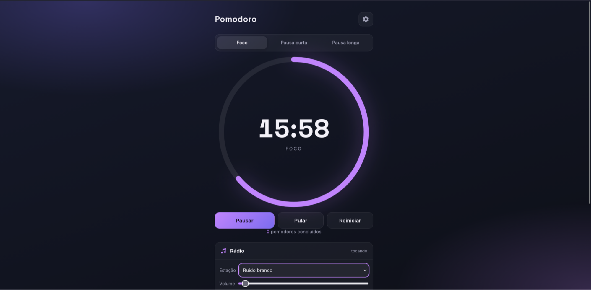
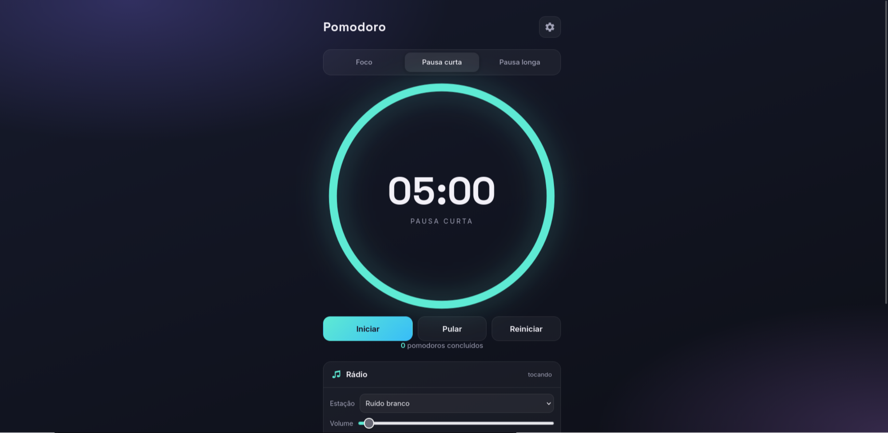
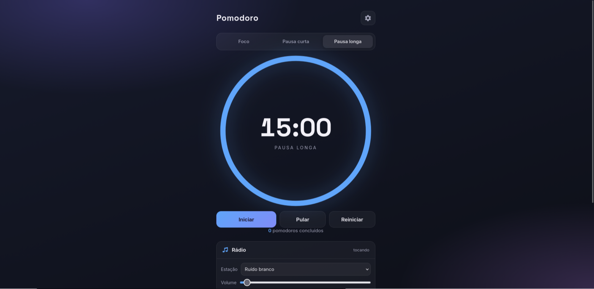
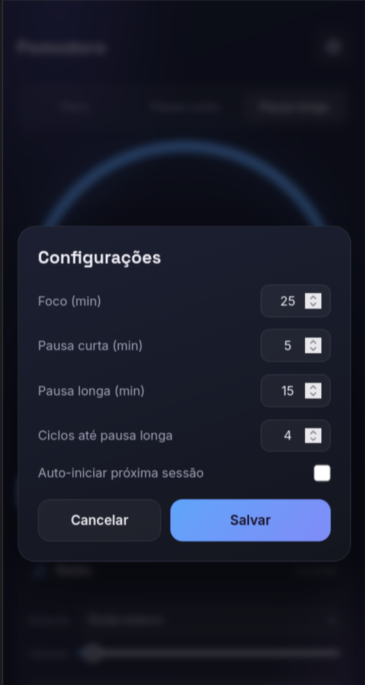
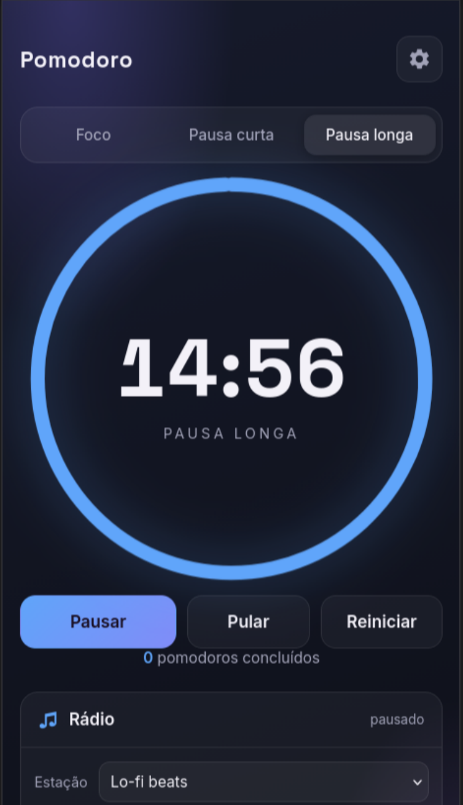

# Pomodoro Clock

Timer da **Técnica Pomodoro** com visual dark lo-fi, anel de progresso e rádio embutida para acompanhar os estudos.

A Técnica Pomodoro é um método de gerenciamento de tempo criado por Francesco Cirillo no fim dos anos 80. Ela divide o trabalho em intervalos (tradicionalmente 25 minutos) separados por pequenas pausas, ajudando a manter o foco e evitar a fadiga.

## Capturas de tela

| Foco | Pausa curta | Pausa longa |
| --- | --- | --- |
|  |  |  |

| Configurações | Visão mobile |
| --- | --- |
|  |  |

## Funcionalidades

- **Anel de progresso** que esvazia conforme o tempo passa.
- **Sessões** de Foco, Pausa curta e Pausa longa, com cores próprias.
- **Durações configuráveis** (foco, pausas e número de ciclos) salvas no navegador.
- **Ciclos automáticos**: após N focos, entra na pausa longa.
- **Auto-iniciar** a próxima sessão (opcional).
- **Pular** e **Reiniciar** a qualquer momento.
- **Alarme sonoro** e **notificação** ao fim de cada sessão.
- **Rádio com estações** embutidas (YouTube): lo-fi, synthwave, jazz, música clássica e som de chuva; play/pause e estação escolhida salva no navegador.
- **Sons ambientes offline** gerados por código (Web Audio): chuva, ruído branco e ondas do mar, com controle de volume.
- **Link personalizado**: cole a URL de qualquer vídeo do YouTube para tocar como estação.
- **Timer sem drift**: o tempo é calculado por timestamp, não por contagem simples.
- Layout **responsivo**.

## Tecnologias

- HTML, CSS e JavaScript puro (vanilla), sem build.
- SVG para o anel de progresso.
- `localStorage` para persistir as configurações.
- YouTube IFrame API para as estações de rádio.
- Web Audio API para os sons ambientes gerados no próprio navegador.

## Estrutura do projeto

```
.
├── index.html
├── assets/
│   └── alarm-sound.mp3
├── screenshots/
│   └── ...
├── scripts/
│   └── script.js
└── styles/
    └── style.css
```

## Como executar

Abra o `index.html` no navegador — o timer e os **sons ambientes** funcionam direto assim.

Para as **estações do YouTube**, é preciso servir a página por HTTP (o YouTube não permite embed em `file://`):

```bash
python3 -m http.server
```

Depois acesse `http://localhost:8000`.

## Testar online

[Clique aqui](https://pomodorotimer-js.netlify.app/) para testar.

## Autor

[Robson Paulo](https://github.com/rabisquim)
